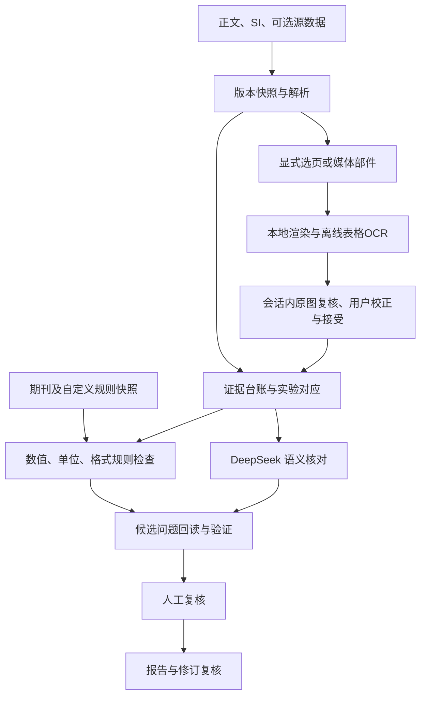

# Paper–SI Audit｜正文与补充信息数据核对插件设计方案

版本：v0.6（公开发布准备；插件版本 0.2.0）  
更新日期：2026-11-09（Asia/Hong_Kong）  
目标宿主：DeepSeek Harness v0.2.2-rc.1 原生插件（官方源码 tag：dsh-v0.2.2-rc.1）  
状态：MVP 0.2.0 已集成；当前验证范围与结果以 [VALIDATION](docs/VALIDATION.md) 为准。真实原件的局部回归、合成表格的实际离线 OCR 与整体科学准确率分别记录，不能相互替代。

## 0. 项目状态与续接入口

本文件是当前设计的主文档。聊天用于讨论，确认后的需求、设计修改和待决事项及时回写到这里。文件持久保存不等于模型在未来自动读取；续接时应先读取本节、变更记录及本次涉及的章节。

### 用户已明确的要求

1. 设计 DeepSeek Harness 软件内的插件，而非另建一个泛化 harness，也不是 Codex 插件。
2. 用于科学论文正文与 Supplementary Information（SI，补充信息）的数据核对。
3. 先提供完整设计方案供审阅；用户随后已授权 MVP 开发和 GitHub 新仓库发布。公开分发按 DeepSeek Harness bundle 规范进行，尚未申请任何第三方索引收录。
4. 将方案录入 Markdown，在反复修改和上下文变长时保留可追溯的项目状态。
5. 增加期刊数据格式规则，允许用户自定义，例如不同数据字段的小数位数要求。
6. 兼容目标固定为 DeepSeek Harness v0.2.2-rc.1（用户原文 v0.2.2rc.1）。
7. 移除独立网页复核面板，在 Harness 原生会话内完成复核。
8. 加入图像表格读取和 HRMS 分子式精确质量复算，保留证据、计算口径与人工确认环节。
9. 公开发布参考官方精确版本规范与已有插件；GitHub 登录使用内置浏览器。公开源码和安装包不得夹带真实论文、报告、个人路径、凭据或本地状态。

### MVP 实现快照（2026-11-09）

0.2.0 在 0.1.1 的实体归因、实验语境、Office 原件读取和执行路径修复基础上，移除网页、HTTP 服务与三栏界面，增加图像证据及 HRMS 条件复算。此前真实案例修复仍见 [修复记录](docs/REPAIR-0.1.1.md)。

- 原生插件当前版本 0.2.0，固定兼容 DeepSeek Harness 0.2.2-rc.1，22 个原生工具；操作入口为 Harness 会话。
- 已实现 TXT/MD、CSV、JSON、DOCX、文本层 PDF、XLSX 以及独立栅格图片导入。DOCX/PDF 的部分覆盖、图像来源和尚未读取的材料单独披露。
- 已实现可识别字段的跨文档核对、ee/er 换算、部分单位归一，以及字段级数字格式、自定义 JSON/YAML 模板和局部例外。
- 图像流程为：按页码或 DOCX 媒体部件选择 → 本地渲染 → 离线 OCR 恢复候选行列 → 查看原图与像素框 → 用户校正/接受 → 核对。不会默认把全部谱图当作表格读取。
- OCR 保存原件哈希、栅格哈希、单元格像素框、置信分数和原始 OCR。人工校正保留原始识别文字及历史记录；未接受、失败和来源修订后的表格不得被当作已核实数据。
- HRMS 以固定版本同位素质量数据复算分子式、离子、加合/失去基团和电荷；中性分子式与最终离子分子式含义不明时并列保留解释，不选择最接近报告质量的结果。告警阈值由用户配置。
- 已实现来源证据回读、人工记录、Markdown/JSON/CSV 导出、运行快照和修订重验。网页面板、HTTP 监听端口和三栏复核界面已从当前版本移除；无需打开额外网页。
- 尚未实现后台任务队列、完整执行中取消/恢复或自动结构确证。
- 模型语义复核由宿主通过证据工具及候选登记完成；尚未进行真实 DeepSeek API 调用或真实论文准确率评估。
- 同名同角色上传自动替换当前材料；改名修订稿可显式指定替换来源，历史运行不变。
- 主数据存储采用项目 JSON 快照与独立复核记录，尚未采用 SQLite。
- 桌面 profile 的包安装、bundle 启用、目录配置和当前会话工具注册分别验证；公开发布不修改使用者的桌面配置。
- 使用方法与边界见 [README](README.md)，兼容测试见 [HARNESS](docs/HARNESS.md)，最终记录见 [VALIDATION](docs/VALIDATION.md)。
- 图像能力与实际读取限制见 [IMAGE-TABLES](docs/IMAGE-TABLES.md)。真实 SI 的媒体清点和 EMF 转换不等于 Table S1 表体已恢复；无法定位的表体继续记为未核验。
- 公开分发使用独立副本，保留原开发材料；通过 GitHub 源码、版本标签和 Release 安装包提供。Node 下限与目标宿主统一为 24.9.0；发布检查及参考仓库见 [PUBLISHING](docs/PUBLISHING.md)。

### 后续建议，尚待审阅

- 采用通用核对核心，首个专业规则包优先面向化学论文。
- 原生插件包含工具、服务和指令；后台任务可作为后续扩展，当前会话内复核已按用户要求取代独立客户端页面。
- 数值计算交给确定性工具，语义理解交给模型，所有问题回验原文证据。
- 首版完成正文—SI 核对、期刊格式配置、双侧证据、人工处理、报告与修订复核的闭环。

### 尚未决定或验证

- 目标版本桌面端安装与真实 DeepSeek 会话验收；目标 CLI 原生工具运行时已验证。
- 首版优先适配的具体期刊及用户自己的格式模板。
- 首批试点论文、源数据类型和人工标注样本。
- 是否需要在后续阶段直接写回 Word；当前设计默认生成建议和报告。
- 通用检出率、误报率、真实模型语义效果、规模化耗时和成本、Windows 隔离效果，尚无完整验收。局部功能测试范围见验证记录。

### 文档维护方式

- 重要修改更新版本和第 15 节，不把讨论中的每种想法都写成已确认需求。
- 保留用户决定、方案理由、未解决问题和当前状态，避免复制整个聊天历史。
- 修改已有设计时更新所属章节，避免在末尾追加互相矛盾的补丁。
- 后续若产生代码、配置模板或验收材料，在本文件中链接其实际位置。

## 1. 定位与预期结果

暂定名称：Paper–SI Audit（论文数据核对）。

核心任务：连接正文、摘要、图表、图注、Methods、SI 和可选原始数据，逐项检查一致性、复算明确的数值，并提供能够回到原文的位置、证据和判断理由。

需要回答四个问题：

1. 同一实验的数据在不同位置是否一致？
2. 报告的数值是否能够由提供的数据和计算口径得到？
3. 正文中的概括性结论是否准确反映支持材料？
4. 数据呈现是否符合选定的期刊规则与用户格式配置？

报告必须同时说明已核对、无法核对和未纳入的范围。没有告警不能解释为论文数据全部正确。

只有正文与 SI 时，主要判断报告的一致性；提供源数据后，才能进一步核验部分数值的推导。二者在报告中区分。

## 2. 核对范围

| 模块 | 核对内容 | 主要输出 |
|---|---|---|
| 跨文档一致性 | 摘要、正文、图表、图注、Methods、SI 的数值、名称、编号和条件 | 双方证据及差异 |
| 数值与单位 | 单位、数量级、百分比、有效位数、不等号及明确公式 | 可复算结果 |
| 实验条件 | 规模、当量、浓度、温度、时间、催化剂负载、光源等 | 条件差异及例外说明 |
| 图表与引用 | Figure、Scheme、Table 和 SI 编号及引用对象 | 缺失、错指、重复、旧版遗留 |
| 材料完整性 | 化合物、样品、实验与表征、源数据的对应 | 覆盖清单与缺失清单 |
| 结论与数据 | 最大值、范围、平均值、排序及“所有底物”等概括 | 支持数据与反例 |
| 专业规则 | yield、ee/er、dr、HRMS、NMR、HPLC/GC 等 | 规则结果与人工复核线索 |
| 期刊格式 | 字段小数位、有效数字、单位、符号、排序、表征格式等 | 规则来源、偏差与修改预览 |
| 修订一致性 | 改动后的数值、格式和文字是否同步更新 | 新问题、仍存在、待重验、已解决 |

深入机理判断作为可选模块，分别列出直接观察、作者解释与进一步推断，不混入确定性数值核对。

## 3. 比较单位与证据台账

比较单位是：**实体＋实验批次＋反应条件＋测量方法＋指标定义＋文档版本**。

相同化合物编号可以对应优化实验、底物范围、放大实验或不同批次。不能只按编号或数字相似度合并。

每条事实记录至少包含：

| 类别 | 字段 |
|---|---|
| 来源 | 文件 ID、版本、哈希、源数据类型 |
| 定位 | PDF 页码及区域；DOCX 段落/表格路径；工作表及单元格；原文摘录校验 |
| 原始表达 | 原始数值字符串、单位、比较符号、显示位数、原文上下文 |
| 标准化 | 规范数值、单位、显示精度及转换过程 |
| 身份 | 化合物、样品、实验、批次、规模、反应条件 |
| 数据口径 | 分离/分析产率、ee/er、独立/技术重复等 |
| 证据类别 | 原始观测、处理结果、作者陈述、作者解释 |
| 读取状态 | 可靠读取、OCR 存疑、身份待确认、来源缺失 |
| 依赖 | 来自哪项实验、由哪些输入计算、支持哪些结论 |

原文和原始数值不被标准化结果覆盖。DOCX 页码受渲染环境影响，不能把临时页码作为唯一稳定定位；以结构路径和摘录定位，必要时关联本次渲染快照。

正文、SI 和原始文件都不自动成为永远正确的一方。已确认两处存在差异，也不等于已经确定哪处错误。

## 4. 完整工作流程

1. 建立项目，选定文件、版本、学科规则和期刊/自定义格式配置。
2. 建立只读源文件快照，记录规则配置快照。
3. 解析段落、表格、图注及图片位置，列出部分读取和失败范围。图像只先清点；用户显式选择 PDF 页码、DOCX 部件或独立图片，再按需裁剪、运行本地离线 OCR。
4. 在 Harness 会话内回读候选表格的原图、单元格像素框和识别文字，由用户校正并决定是否接受；再建立实体、实验、图表和数据类型的对应关系。OCR 读取、接受转录与确认科学结论分别记录，歧义匹配进入待确认队列。
5. 运行确定性数值、单位、编号和格式检查；HRMS 按已知分子式口径、离子和电荷条件复算，口径不明时并列报告候选解释。
6. 运行 DeepSeek 语义核对，检查跨段对应、条件例外、概括性结论等。
7. 回读原文，验证候选问题的脚注、实验身份、数值和证据位置。
8. 生成人工复核清单，记录判断理由和处理状态。
9. 导出问题报告、问题台账和覆盖报告。
10. 新版本导入后按依赖关系增量复核，并区分内容修改与格式规则修改。

每一步保存状态。API 超时、解析失败、上下文截断、预算耗尽等一律标为未完成，不能计为通过。

## 5. 核对架构与职责



- 确定性工具负责有明确输入和公式的计算、单位换算、格式匹配。
- DeepSeek 负责语义对应建议、条件例外识别和潜在问题发现。
- 验证器负责来源 ID、摘录、定位、实验身份、规则适用条件和计算输入的检查。
- 人工复核负责决定正常差异、需要修改的来源，以及依赖科学判断的问题。

模型输出必须引用实际存在的证据 ID 与规则 ID。无有效来源的判断不得作为已确认冲突发布。多个模型同意不能替代证据。

首版采用一个调度器和任务队列，按需要对高风险候选问题二次复核，不默认启动大量重复审阅任务。

## 6. 化学专业规则

| 项目 | 设计要点 |
|---|---|
| 产率 | 核对限制试剂、化学计量、产物形式、质量、物质的量及产率定义 |
| ee/er/dr | 保留定义，合法换算；核对峰身份、样品标签及积分依据 |
| HRMS | 核对分子式、离子形式、加合物和计算质量；与产率摩尔质量计算分开 |
| NMR | 核对编号、溶剂、频率、文字记录和谱图对应；结构确证保留人工判断 |
| HPLC/GC | 核对样品、对照、积分与计算，不凭保留时间单独判断绝对构型 |
| 立体化学 | 追踪归属来源；ee 数据不替代绝对构型证据 |
| 光化学 | 核对已报告的波长、功率、距离、反应器、照射时间等 |
| 机理证据 | 区分观察、作者解释及尚未由现有材料决定的结论 |

需专门覆盖的正常差异与边界：

- 分析产率、分离产率和不同批次结果不能强行对等。
- 94.6% 与 95% 可能仅有显示精度差异，不能使用统一百分比容差掩盖其他冲突。
- >99% 不转换为 100%；未检出不转换为 0。
- 碳谱信号数少于碳原子数不能单独作为表征错误证据。
- 表征数据不完整、图像不清或未提供源数据，标为无法核验或待复核。

### 6.1 图像表格的证据与准入

- PDF 先列页码，DOCX 先列 `word/media/` 部件与图像锚点，再由用户选择目标。单页渲染或媒体转换只产生图像资产，不计为完成表格读取。
- 使用本地 Tesseract.js、WASM 和随依赖安装的 English traineddata 进行实际 OCR。全网格按图线与单词位置恢复行列；无边框表格仅给出候选列。缺词、脚注、上下标、不等号和合并单元格需要查看原图。
- 源 PDF/DOCX 哈希、渲染图像哈希、页码/部件定位、裁剪范围、像素框、置信分数和原始文字共同构成证据。置信分数不是科学正确率；DOCX XML 段落编号不冒充 Word 页码。
- 表格初始状态为 `needs_review`，读取失败为 `failed`。只有明确的用户决定才能接受或校正转录；接受只说明用户检查了读数，不代表验证了测量、结构或论文结论。
- 人工校正保留 `originalOCRText` 和处理历史，不覆盖源文件或既有运行。原件修订后，旧表格退出新运行的有效证据，历史快照继续保留。
- 未选择的谱图、结构图和 OLE 对象不自动进入表格 OCR。EMF/WMF 在 Windows 通过系统 GDI 转换；不支持或失败时明确报告，要求导出图片或 PDF 页。

### 6.2 HRMS 精确质量条件复算

- 计算使用固定版本的同位素原子质量、显式同位素标签和电子质量修正，按电荷数换算 m/z。常规 EI-MS 记录不会仅因包含质量数字而被升级为高分辨测量证据。
- `neutral` 表示给出的是中性分子组成，需应用 `[M+H]+` 等离子加合/失去基团；`ion` 表示给出的是最终离子组成，不能重复加合。默认 `ambiguous` 会保留可用的条件解释。
- 未明确分子式口径时，不从报告 calculated/found 中挑选最接近的候选来反推含义。缺少电荷、离子形式、支持元素或完整表达时报告不足，不擅自假定 `[M+H]+`。
- 比较结果保留理论值、报告值、Da/mDa/ppm 偏差、舍入相容性、质量数据版本、来源与解析引用。用户设置 ppm 及可选 mDa 阈值；软件默认值和用户阈值均不宣称为某期刊要求。
- HRMS 结果是对指定组成与约定的数值复算，仍需确认分子式、加合物和实验信息；不能替代结构确证、同位素包络、仪器分辨率或样品真实性检查。

## 7. 期刊格式配置与用户自定义规则（v0.2 新增）

### 7.1 目标

允许不同期刊、项目、文档区域和数据字段采用不同呈现规则。用户不需要改代码即可建立、复制、修改、导入、导出和选择规则模板。

格式规则检查与科学数据核对分开。数据可以数值一致但格式不符，也可以格式统一但科学数据不一致。一次格式修改不能让真实数值冲突自动消失。

没有选择期刊配置时使用用户自定义模式，不推断一个未指定的目标期刊。

### 7.2 配置字段

| 配置类型 | 示例 |
|---|---|
| 数据字段 | ¹H、¹³C 及其他核种的 NMR 化学位移 δ、耦合常数 J、仪器频率、积分、HRMS calculated/found、产率、ee、温度 |
| 数字策略 | 小数位数、有效数字、最少/最多显示位数、尾随零和科学计数法；互相冲突的策略不能同时启用 |
| 舍入策略 | 明确的十进制舍入方式；不默认截断 |
| 单位 | 期望单位、数值与单位间空格、单位符号 |
| 表达 | ±、范围连接符、不等号、百分号、正负号、上下标 |
| 顺序与标签 | 数据字段排列、核种/频率/溶剂位置、HRMS 离子标记等 |
| 适用范围 | 正文、图注、SI 实验、表征段、表格列、单个字段例外 |
| 处理方式 | 仅提示、生成修改预览、要求人工确认；当前阶段不直接改原稿 |

“核磁三位或四位小数”在配置时必须进一步指定是哪一个字段。¹H δ、¹³C δ、J 和 HRMS 数值分别配置，不共享一条笼统的小数规则。

### 7.3 规则来源与可信状态

每个期刊模板及其规则记录：

- 期刊名、文章类型、规则 ID、规则版本和生效范围。
- 来源类型：期刊官方要求、官方推荐、模板示例、实验室习惯、用户自定义。
- 来源链接或用户提供的文件位置、原文摘录、核对日期。
- 状态：已人工核对、待核对、已过期/被替代。

从示例论文总结出来的习惯不能标为期刊强制要求。未查阅具体期刊指南前，不预设某个小数位数是其正式要求。

模板更新需显示新旧规则差异。现有项目固定使用已选规则快照，不因远端模板更新而静默改变检查结论。

### 7.4 规则层级与冲突处理

呈现建议的默认继承顺序为：学科基础模板 → 期刊模板 → 项目设置 → 局部字段例外，越具体的配置越优先；每条结果展示实际生效规则及来源。

期刊合规检查单独保留：用户可以覆盖呈现偏好，但若与已核实的期刊强制要求冲突，仍显示偏离提示，不能因覆盖而改判为符合期刊要求。停用某项检查时，覆盖报告记录未执行项。

规则配置编辑器需要检测字段重叠、互斥数字策略、无效位数、未知单位和无效范围。首版不支持用户任意脚本执行；高级匹配若开放，须限制表达式复杂度与执行时间。

### 7.5 原始精度、显示精度与舍入

- 保存原始字符串、可知的测量/来源精度以及目标显示规则；不知道来源精度时明确标为未知。
- 数值相等判断、显示格式判断和测量不确定度判断分别处理。
- 复算使用十进制数值或精确表示，避免二进制浮点使舍入边界产生假差异。
- 补零可以作为明确的展示约定，但不能提高测量精度；来源精度不足或不明时提示人工确认。
- 降低显示位数时保留原值和预览，并评估是否改变阈值、排序或概括性结论。
- 不等号、检出限、范围端点、均值±误差和科学计数法采用各自规则，不对整个字符串机械四舍五入。
- 不生成将 <0.001 舍入成 <0.00 之类改变科学含义的修改建议；进入需人工处理状态。

### 7.6 用户配置流程

1. 在 Harness 会话中选择已核实的期刊模板或用户自定义模板。
2. 通过 JSON/YAML 配置当前支持的字段位数、单位、范围和例外；更丰富的标签、顺序规则仍按实际实现范围披露。
3. 查看原始表达、修改预览及实际触发的规则；不需要网页格式配置页。
4. 检查规则冲突，保存为具名、带版本的模板。
5. 项目选用模板并生成规则快照。
6. 运行后按规则筛选问题；局部例外需保留理由和范围。
7. 使用 JSON/YAML 导入导出模板，供其他论文复用。模板与论文数据分开导出，默认不夹带原文或原始数据。

### 7.7 示例配置（仅演示，不代表任何期刊要求）

以下配置使用当前声明式 Schema。例子中的 3 位、4 位等数字仅用于说明用户可分别设置字段。

```yaml
schema_version: 1
profile:
  id: custom-demo
  name: 用户自定义演示模板
  version: 1.0.0
  source_type: user_defined
  journal: null
rules:
  - id: nmr-h1-shift
    field: nmr.h1.chemical_shift
    scope: si.characterization
    requirement: user_preference
    number_format:
      mode: decimal_places
      digits: 3
      rounding: half_up
    expected_unit: ppm
    action: preview_only
  - id: nmr-c13-shift
    field: nmr.c13.chemical_shift
    scope: si.characterization
    requirement: user_preference
    number_format:
      mode: decimal_places
      digits: 4
      rounding: half_up
    expected_unit: ppm
    action: preview_only
  - id: nmr-coupling
    field: nmr.coupling_constant
    scope: si.characterization
    requirement: user_preference
    number_format:
      mode: decimal_places
      digits: 1
      rounding: half_up
    expected_unit: Hz
    action: preview_only
  - id: hrms-mz
    field: hrms.mass_to_charge
    scope: si.characterization
    requirement: user_preference
    number_format:
      mode: decimal_places
      digits: 4
      rounding: half_up
    action: preview_only
```

### 7.8 输出示例

格式问题：同一表征字段在 SI 使用了不同显示位数。报告列出原文、目标格式、规则 ID、来源和修改预览；不把它算作科学数据错误。

科学数据问题：正文为 98% ee，SI 对应 er 为 98:2；在峰身份及计算依据成立时，后者对应 96% ee。修改小数显示不能消除此冲突，仍需确认批次、积分与正确来源。

## 8. DeepSeek Harness 原生实现方案

建议一个安装包内部划分模块，核心审计逻辑与宿主适配层分开，不预先拆成大量独立插件。

| 组成 | 职责 |
|---|---|
| 原生组合包 | dsh.bundle、cordis.patch.yml、依赖和兼容版本 |
| 核对服务 | 项目、台账、规则、视觉资产和问题状态；当前使用本地 JSON 快照及独立记录 |
| 模型工具 | 有边界的检索、读证据、复算、问题登记与复核 |
| 指令与技能 | 检查顺序、证据纪律、不确定性处理 |
| 图像模块 | 选页/部件渲染、离线 OCR、像素框及来源哈希；不自动接受转录 |
| 化学复算 | HRMS 分子式与离子条件计算、质量数据和用户配置阈值 |
| 会话内复核 | 原文/图像证据、人工校正、接受或拒绝、问题判断；无独立网页或 HTTP 服务 |
| 后续任务扩展 | 解析与批量检查的后台调度、恢复机制；尚未完成 |
| 会话绑定 | 项目、运行记录和聊天上下文的关联 |

MVP 0.2.0 提供 22 个原生工具，完整清单见 [宿主接入说明](docs/HARNESS.md)。图像工具覆盖准备/清点、图像证据读取、表格 OCR、表格清单及人工决定；HRMS 工具提供独立复算和项目口径/阈值配置。修订复核通过 `paper_audit_run` 创建新运行实现，没有另行发布 `paper_audit_recheck`。

工具使用目标 tag 的 `defineTool` / `ctx.tools.register`；实际执行结果和配置 Schema 验证见 [VALIDATION](docs/VALIDATION.md)。当前插件不启动 HTTP 端口、不提供网页工作台，也不要求原生客户端内嵌页面。`ctx.jobs` 后台调度及更充分的执行中取消/恢复保留为后续扩展。

建议宿主适配层使用 TypeScript；文档或科学数据解析器按需要采用独立工作进程。模型调用优先复用 Harness 的模型配置和凭据，不硬编码具体模型名称或价格。

## 9. Harness 会话内复核与问题状态

按用户要求，独立网页面板、HTTP 服务和原设计的三栏界面从当前版本移除。用户在 Harness 会话中选择项目，检索问题，读取正文/SI 双方证据，查看复算和规则，再登记人工决定。

期刊/自定义格式通过声明式模板配置。图像由登记资产工具读取：宿主必须具备图像输入及附件存储能力才能把图片实际送入模型；能力不足时返回未送达原因，本地 OCR 仍可使用，不假装模型已看图。图像转录与科学问题使用各自的复核状态。

每条问题包含：

- 问题类型：科学数据、实验对应、证据完整性、格式或引用等。
- 严重程度：是否影响核心结论、关键数据或一般呈现。
- 证据状态：已确认差异、待核实、证据不足、不可比较。
- 处理状态：未处理、已确认、合理差异、提取错误、已修改待复核、已复核关闭。
- 双方来源、摘录或截图、复算输入、规则及版本、待确认事项。

“已修改”不直接关闭问题。新版本复核后再关闭；格式规则变更引发的状态变化单独记录，不能伪装成原始文档已修复。

表格的 `needs_review`、`accepted`、`rejected` 表示用户对转录的决定，独立于原始 OCR 的读取成败。表格接受后仍须核对实验身份、批次、测量方法和来源版本；用户撤回接受或修订源文件时，后续运行不再沿用该表格作为已接受证据。

## 10. 报告与导出

| 成果 | 内容 |
|---|---|
| 核对报告 | 高影响问题、双方证据、计算过程、建议确认事项 |
| 问题台账 | 问题及证据 ID、人工处理记录，支持 CSV/JSON |
| 覆盖报告 | 文件、页面、表格、实体、检查项的完成度及失败范围 |
| 图像证据 | 源文档/栅格哈希、页码或部件、像素框、原始 OCR、校正及接受历史 |
| HRMS 计算记录 | 条件分子式解释、离子和电荷、理论 m/z、偏差、配置阈值及质量数据来源 |
| 格式合规报告 | 模板和规则版本、来源可信状态、偏差与例外 |
| 修订差异报告 | 新增、持续、待重验、解决的问题及影响范围 |

报告表述限定为“在本次材料和已完成检查范围内，未发现该类冲突”。

模板可以单独导出；论文证据、运行记录和模型上下文不自动随模板打包。

## 11. 隐私、安全与故障处理

- 原文件只读，结果和建议保存在独立项目区域。当前设计不自动覆盖原稿。
- 本地解析与存储优先；表格 OCR 使用本地模型数据，不额外上传图片。宿主模型会接收工具结果中的相关片段；向图像模型实际发送附件时单独说明送达情况。
- 宿主会话日志也可能保存已进入模型上下文的片段，不能忽略其数据副本。
- 文档内文字、宏、外链和所谓指令均作为数据，不执行、不改变工具权限。
- 读写路径限定在项目授权范围；模型不获得任意脚本执行能力。
- 解析器设置资源限制与超时，防止异常文件、路径穿越和无界处理。
- 导出表格时处理公式注入风险。
- 工具白名单不是操作系统沙箱；Windows 隔离能力需实机验证，不提前宣称强隔离。
- 统计规律或重复图像只能作为复核线索，不据此自动输出造假判断。

## 12. 版本、增量复核与运行记录

保存源文件哈希、解析器/规则/提示词版本、模型配置、复算输入、项目格式模板和例外配置。

0.2.0 同时保存源文档与栅格两级哈希、OCR/人工校正历史、表格接受状态以及 HRMS 配置修订。新运行冻结当次有效证据和设置；后续人工修改或重新识别不得改写历史运行。

内容变化沿证据依赖关系传播：脚注变化可能影响多个条件比较，编号变化可能影响全文实体匹配。来源消失或无法重新定位时标为证据失效待核实，不自动认定已解决。

格式模板变化与论文内容变化分开：仅改小数规则可重跑相关格式检查；若格式舍入影响最大值、阈值或结论，再触发下游核对。

保存简明判断理由与证据，不依赖隐藏推理过程。控制重试次数、模型调用预算和并发；支持取消与从已完成阶段续接，具体恢复机制在实现时验证。

## 13. 开发阶段建议

以下保留完整产品的阶段目标，不表示 MVP 0.2.0 已完成每项能力；当前实际范围以第 0 节、README 和验证记录为准。独立网页与三栏面板已按用户要求移除，不列为当前开发目标。

| 阶段 | 交付范围 | 验收关注 |
|---|---|---|
| 第一阶段 | DOCX、可检索 PDF、CSV/XLSX；编号/条件/数值/单位；期刊和自定义字段格式；双侧证据、人工处理、报告与增量复核 | 完整闭环、显式失败、规则快照、原始值保留 |
| 当前 0.2.0 增量 | 显式选页/部件的图像表格离线 OCR、转录复核和 HRMS 条件精确质量复算 | 实际读取、来源哈希与像素框、未接受 OCR 的证据门槛、口径歧义与阈值来源 |
| 第二阶段 | 化学规则深化；期刊模板库；表征文字与谱图标签对应；复杂表格和格式建议扩展 | 专业边界、来源核实、正常差异误报 |
| 第三阶段 | 大规模扫描 SI、结构辅助识别、仪器格式、复杂统计；按授权评估 Word 写回 | 每类新增能力单独验证 |

期刊配置和用户自定义格式已纳入首版，不推迟为远期功能。首版可以从少量用户明确指定的字段和模板开始，不声称覆盖所有期刊。

## 14. 验收设计

建立真实错误、人工植入错误、正常差异三类标注样本，按论文或实验家族划分开发集和盲测集。

分别评估证据定位、实体匹配、计算正确性、各类问题检出与误报、失败显式率和人工复核耗时。科学判断、数值规则和格式规则分别报告，发布门槛在试点后冻结。

格式规则专项用例至少包括：

1. 不同核种、化学位移、J、HRMS 使用不同数字策略。
2. 小数位与有效数字冲突、项目覆盖、局部例外、规则停用及来源缺失。
3. 十进制舍入边界、负数、科学计数、范围、不等号、误差表达。
4. 显示补零不能抬高测量精度，降低位数不能悄悄改变阈值结论。
5. 用户偏好覆盖不消除已核实期刊强制要求的偏离提示。
6. 新模板版本不静默改动历史项目；规则更新能准确识别需重验范围。
7. 导入导出后规则及版本一致，不夹带论文数据，不执行脚本。

图像专项验收覆盖实际离线 OCR、栅格及 PDF 渲染、媒体选择、像素框/哈希、人工校正、接受门槛、源修订失效和历史快照。HRMS 专项验收覆盖同位素、离子加合/失去基团、电荷、双分子式口径、偏差与不支持表达。运行时及独立复核的已执行范围、结果和遗留项统一见 [VALIDATION](docs/VALIDATION.md)，本方案不提前填入尚未完成的测试数量。旧版浏览器检查仅属于历史版本记录，不代表 0.2.0 仍保留网页。真实论文错误集、盲测和实际模型语义准确率评估仍未完成。

## 15. 变更记录

| 版本 | 日期 | 变更 | 状态 |
|---|---|---|---|
| v0.1 | 2026-11-09 | 聊天中提出完整原生插件方案：证据台账、实验对齐、确定性计算、人工复核、增量复核 | 已提供用户审阅 |
| v0.2 | 2026-11-09 | 将既有方案整理为本 Markdown 主文档；记录明确需求与待决事项；新增期刊/用户格式模板、字段级位数规则、来源版本、覆盖冲突与精度保护；纳入首版 | 当时为设计草案，尚未实现 |
| v0.3 | 2026-11-09 | 用户授权 MVP 开发并固定宿主 0.2.2-rc.1；落地原生工具、解析、规则、格式模板、本地复核和报告；记录目标运行时实测及尚未实现项 | 插件 0.1.0 已实现，验收与分发记录见 docs |
| v0.4 | 2026-11-09 | 根据真实报告修复实体、MS、原件大小和覆盖披露；新增当量候选、格式分组、执行路径与激活诊断；真实原件只读回归 | 插件 0.1.1；80 项检查通过；实际桌面启用仍单独待处理 |
| v0.5 | 2026-11-09 | 按用户要求移除网页/HTTP/三栏面板；扩展为 22 个原生工具；增加选页/部件、实际离线图像表格 OCR、用户校正/接受与证据快照；加入保留双分子式口径歧义的 HRMS 精确质量复算和用户阈值配置 | 插件 0.2.0 已集成；已执行验证范围和结果见 docs/VALIDATION.md；桌面启用及科学准确率单独验收 |
| v0.6 | 2026-11-09 | 用户授权新 GitHub 仓库发布；按官方 bundle 规范整理独立公开副本、脱敏文档、兼容声明、可发现元数据、固定版本安装与 Release 校验 | 发布准备；实际远程创建和发布结果另行验证，不代表官方审核或索引收录 |

## 16. 技术参考

以下为 v0.1 设计时已查阅的官方资料；不代表用户本机已安装版本与其完全一致。

- [DeepSeek Harness 项目说明](https://github.com/deepseek-ai/deepseek-harness/blob/master/README.zh.md)
- [插件打包与安装](https://github.com/deepseek-ai/deepseek-harness/blob/master/docs/user/develop/basic/publish.zh.md)
- [工具编写参考](https://github.com/deepseek-ai/deepseek-harness/blob/master/docs/cookbook/adding-a-tool.zh.md)
- [扩展机制](https://github.com/deepseek-ai/deepseek-harness/blob/master/docs/cookbook/extension-cookbook.zh.md)
- [配置表单与客户端模块](https://github.com/deepseek-ai/deepseek-harness/blob/master/docs/cookbook/adding-a-settings-card.zh.md)

具体期刊格式来源：尚未选定，待按用户指定期刊或用户提供模板核实，不在本草案中虚构期刊规则。

0.2.0 图像实现资料见 [IMAGE-TABLES](docs/IMAGE-TABLES.md)；栅格边界读取另依据 [Google WebP Lossless 位流规范](https://developers.google.com/speed/webp/docs/webp_lossless_bitstream_specification)。HRMS 的固定质量数据、版本与来源随复算记录保存，不能以本方案中的设计说明替代实际计算来源。


## 0.3.0 核磁与图片检查

实现边界与用法见 docs/NMR-AND-IMAGES.md。核磁按化合物记录关联分子式及报告的 1H 积分、13C 信号/标注碳数，保留离子口径候选，缺项不判通过。图片比较登记并校验哈希的整图/整页，返回完全重复、变换相似及多处引用候选；覆盖范围包括未读、失败、过期和超限。结果纳入原有报告和人工复核，源文件只读。


## 0.4.0 科学核对工作流

按用户确认顺序完成档案/清单、局部图片、谱图标注及实验算术、验证集。阶段记录见 docs/ROADMAP-0.4.md，用法及限制见 docs/SCIENTIFIC-WORKFLOW.md。配置、人工关联和谱图转录均有独立版本；跨批次图片比较不拆分项目。真实论文的小样本参考标签与合成测试分别报告，不能推断整体准确率。


## 0.5.0 四项完善

图表与结论交叉核对、修订问题闭环、真实实验段落局部解析、整篇材料覆盖及任务恢复的实现与边界，统一记录于 docs/WORKFLOW-0.5.md。原生工具增加至 38 个；项目任务、引用、运行和人工决定分别留存。
